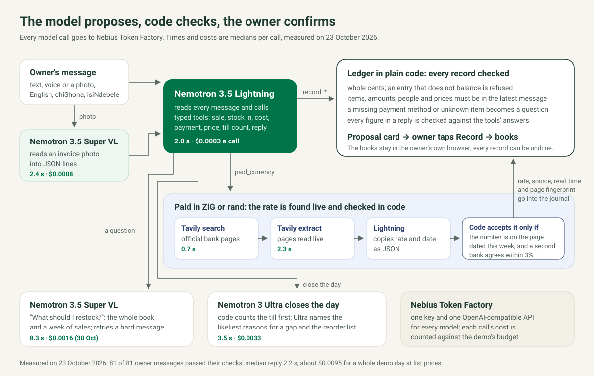

# Imali AI shop agent on NVIDIA Nemotron

**Say what you sold. Ask what you made.** A shop owner types a line, speaks it or photographs a supplier's invoice. The agent turns it into the sale, the stock and double-entry books, checks every figure in plain code, and records nothing until the owner taps Record. It runs on four NVIDIA Nemotron models served by Nebius Token Factory, with Tavily reading the banks' rate pages when a customer pays in ZiG or rand.

- Live demo: https://imali-ai-shop-agent.vercel.app
- Film (2:32): https://youtu.be/MKX0xmoecNM
- Built for the Nebius × NVIDIA Global AI Hackathon, Best Apps and Agents track
- Open source under the MIT licence. The shop, people, invoice and figures in the demo are invented.


## Results, measured on Token Factory

Measured on 23 October 2026 with `tools/eval-live.mjs` against the live Token Factory endpoints, on the code in this repository. Each owner message is checked against the record it should produce: the kind of record, the amount in cents, the payment method or customer where it matters, or the right model answering a question. The result files are in `submission/`.

| Check | Messages | Passed | Median reply | Slowest |
| --- | --- | --- | --- | --- |
| The demo day as one conversation (9 messages, each record confirmed before the next), run 3 times | 27 | 27 | 2.1 s | 6.8 s |
| 18 single messages (English, chiShona, isiNdebele, a photo, an unknown item, no payment method, a rate question), run 3 times | 54 | 54 | 2.2 s | 8.6 s |

| Model on Token Factory | Job | Calls | Median per call | Cost per call (list price) |
| --- | --- | --- | --- | --- |
| Nemotron 3.5 Lightning | reads every message, calls typed tools | 83 | 2.0 s | $0.00033 |
| Nemotron 3.5 Super VL | reads an invoice photo into JSON lines | 6 | 2.4 s | $0.00081 |
| Nemotron 3 Super | answers "what should I restock?", retries a hard message | 6 | 5.5 s | $0.00104 |
| Nemotron 3 Ultra | closes the day | 6 | 3.5 s | $0.00325 |

A whole demo day of nine messages cost $0.0095 at Token Factory's list prices. Tavily search took a median 0.7 s and Tavily extract 2.3 s per lookup. With Nemotron 3 Nano as the router, an earlier run of 17 of these messages passed 42 of 51: it answered a credit sale with a question, invented a delivery when the owner paid a supplier, and recorded paraffin as candles. Nemotron 3.5 Lightning, at the same price, passed those, and became the router.

## How it works



### NVIDIA Nemotron: each job on the model that fits it

Lightning reads every message, so it has to be fast and cheap: 30B parameters with 3B active, built for tool calls, with reasoning switched off (`chat_template_kwargs: {"enable_thinking": false}`). Super VL reads photos. Super gets the questions that need thought, with the whole book and a week of sales, and takes over a message when Lightning's tool calls fail twice. Ultra runs once a day to close the books. The page shows, for every message, which model ran, how long it took, how many tokens it used and what it cost.

### The model proposes, code checks, the owner confirms

The models never write to the books. Lightning's tool calls go to a small ledger (`public/js/ledger.js`) that builds each entry in whole cents and refuses anything that does not balance. Around it, code holds the model to the owner's words:

- a record's items, amounts, people and prices must appear in the owner's latest message, so the model cannot reach back into the conversation or fill in a number;
- a sale with no payment method, an unknown item or a credit sale with no customer becomes a question;
- the day is closed only with the cash the owner counted;
- every figure in a reply about new records must come from the owner's words or a tool's answer, otherwise the reply is replaced by a confirmation written from the checked records;
- Lightning sometimes repeats its tool calls until it reaches its token limit, so each distinct call is kept once and the router's answer is capped at 450 tokens.

### Nebius Token Factory

One key and one OpenAI-compatible endpoint serve all four models, so routing a job to a different size is a change of model id. Tool calling, JSON mode and `tool_choice: "required"` work as documented. The demo counts the list-price cost of every call against a lifetime budget kept in Upstash Redis and stops calling models when it is spent.

### Tavily: exchange rates read live and checked in code

Zimbabwean shops take US dollars, ZiG and rand. When a customer pays in another currency, or the owner asks for a rate:

1. Tavily search looks only at official domains (Zimbabwe's central bank, its development bank IDBZ, and commercial banks).
2. Tavily extract reads the rates pages as they are now, because a search index can hold an older copy of a page.
3. Lightning copies each page's buying, selling and mid rate and its date as JSON.
4. Code accepts a rate only if that exact number is printed on the page it came from and the page is dated within the last week. It takes the mid rate, or works out the midpoint of the buying and selling rates itself. When two banks give a rate, they must agree within 3%, or the owner is asked which rate was used.
5. The rate, the page, its date, the time it was read and a fingerprint of the text read go into the journal entry, so the books carry their own audit trail.

## Run it

You need Node.js 20 or newer and a Nebius Token Factory API key. There are no packages to install.

```sh
git clone https://gitlab.com/ebenworks-systems/imali-ai-shop-agent.git && cd imali-ai-shop-agent
NEBIUS_API_KEY=your-key TAVILY_API_KEY=your-tavily-key npm start
```

Open http://localhost:5180 and tap the examples under the chat, in order, tapping Record on each card. `TAVILY_API_KEY` is optional: without it, a payment in another currency asks the owner for the rate. `.env.example` lists the other settings: model ids per job and the limits for a public copy.

```sh
npm test                                  # 68 tests: ledger, agent loop, rates, server and limits, no network
NEBIUS_API_KEY=your-key npm run eval      # the 18 messages against Token Factory; add -- --day for the demo day, -- --runs 3 to repeat
```

## Limitations

- The voice button uses the browser's own speech recognition, not a model; a Nemotron audio model on Token Factory's serverless endpoints would replace it.
- The checks above are our own test set of 18 messages and one demo day, written for this shop; they are not an independent benchmark.
- Tavily finds a dated ZiG rate on one bank's page (IDBZ) most days, so the ZiG rate is usually checked against its page but not against a second bank; the rand is checked against two banks.
- A rate page that changes its layout can stop giving a reading; the agent then asks the owner for the rate instead of guessing.
- The demo keeps the books in the visitor's browser for one day and one invented shop; Imali AI itself runs the full product.

## Hosting

The public demo runs on Vercel: the page is static and `api/agent.js` is a Node function that calls Token Factory with the key from the environment. The key never reaches the browser. Each address may send 30 requests in ten minutes, the whole demo has a daily ceiling, and model calls stop once the demo's lifetime budget is spent; the counts live in Upstash Redis so they hold across serverless instances. The server keeps nothing else, so several judges can use it at once.

## Why

Imali AI is Africa's smartest AI Business OS: one AI agent runs sales, stock, staff, suppliers and double-entry books from a text, voice note or photo, in nine languages. Most small shops keep no records or a paper book, so they cannot see their profit, chase what they are owed or show a lender a history. Imali AI was built, tested and piloted with users from April 2026, and launched on 21 October 2026. This repository is new code written for the hackathon: it rebuilds Imali AI's core loop on open NVIDIA models served by Nebius Token Factory, and includes no Imali AI product code.

## Layout

| Path | What it does |
| --- | --- |
| `public/index.html`, `public/styles.css`, `public/app.js` | The page: chat, proposal cards, live books, model route |
| `public/js/ledger.js` | Double-entry ledger shared by the browser and the server |
| `public/js/shop.js` | The invented demo shop and the example messages |
| `server/agent.js` | Tools, prompts, the routing between the four models and the checks on their answers |
| `server/rates.js` | Tavily search and extract, and the checks on every exchange rate |
| `server/nebius.js` | Token Factory client, model ids and list prices |
| `server/limits.js` | Per-address and daily limits, and a lifetime budget counted from each call's cost |
| `server/index.js`, `api/` | Local server and the hosted functions |
| `tools/eval-live.mjs` | The live check against Token Factory |
| `docs/architecture.svg` | The diagram above |

## Licence

MIT, © 2026 Ebenworks Systems (Private) Limited. Geist and Newsreader are under the SIL Open Font License (`public/fonts/`). Imali AI is an Ebenworks product.
