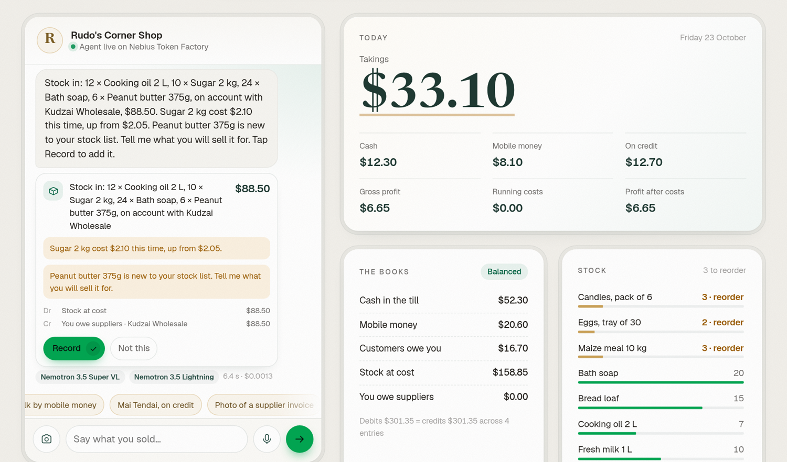

# Imali AI shop agent on NVIDIA Nemotron

**Say what you sold. Ask what you made.** A shop owner types a line, speaks it or photographs a supplier's invoice. The agent turns it into the sale, the stock and double-entry books, checks every figure in plain code, and records nothing until the owner taps Record. It runs on four NVIDIA Nemotron models served by Nebius Token Factory.

- Live demo: https://imali-ai-shop-agent.vercel.app
- Built for the Nebius × NVIDIA Global AI Hackathon, Best Apps and Agents track
- Open source under the MIT licence. The shop, people, invoice and figures in the demo are invented.



## Why

Imali AI is Africa's smartest AI Business OS: one AI agent runs sales, stock, staff, suppliers and double-entry books from a text, voice note or photo, in nine languages. Most small shops today keep no records or a paper book, so they cannot see their profit, chase what they are owed or show a lender a history. Imali AI was built, tested and piloted with users from April 2026, and launched on 21 October 2026.

This repository is new code written for the hackathon. It rebuilds Imali AI's core loop, a message in and checked books out, on open NVIDIA models served by Nebius Token Factory. No Imali AI product code is included.

## How it uses NVIDIA Nemotron on Nebius Token Factory

Every message makes runtime calls to the Token Factory inference API (`https://api.tokenfactory.nebius.com/v1/chat/completions`). Each job goes to the Nemotron model that fits it, the way the track brief suggests: Nano for the fast everyday calls, the bigger models only where they earn their cost.

| Job | Model on Token Factory | Why this size |
| --- | --- | --- |
| Read every message and call typed tools (record a sale, stock in, a cost, a payment, a till count, a price change) | `nvidia/NVIDIA-Nemotron-3-Nano-30B-A3B` | 3B active parameters: quick, multilingual and about $0.06 per million input tokens, so every message can use it |
| Read a photo of an invoice, delivery note or stock list into structured lines | `nvidia/Nemotron-3.5-Super-VL` | Reads text and images; JSON mode gives clean line items |
| Answer questions that need thought ("what should I restock?"), and take over a message when Nano's tool calls fail twice | `nvidia/nemotron-3-super-120b-a12b` | Stronger reasoning over the whole book and a week of sales |
| Close the day: explain a till shortfall from the day's records and write tomorrow's reorder list | `nvidia/Nemotron-3-Ultra-550b-a55b` | The hardest reasoning of the day, once a day, so its price stays small |

The page shows the route for every message: which model ran, why, how long it took, how many tokens and what it cost at Token Factory's list prices.

### The model proposes, code checks, the owner confirms

The models never write to the books. Nano's tool calls go to a small ledger (`public/js/ledger.js`) that builds each entry in whole cents and refuses anything that does not balance. It uses the shop's price list unless the owner names a price, moves stock at cost, flags a price that moved on an invoice or a total that does not add up, and answers with a question instead of guessing (an unknown item, a credit sale with no customer, a missing payment method). Figures the agent quotes come from the ledger through a read tool, not from the model's memory. The owner confirms each record with one tap and can undo any of them.

```
owner's words or photo
  ├─ photo? ─▶ Nemotron 3.5 Super VL ─▶ JSON lines ─┐
  └──────────────────────────────────────────────────┴─▶ Nemotron 3 Nano + tools
                                                          ├─ record_* ─▶ ledger checks ─▶ proposal card ─▶ owner taps Record
                                                          ├─ get_figures ─▶ ledger figures
                                                          ├─ ask_analyst ─▶ Nemotron 3 Super
                                                          ├─ close_day ─▶ till count in code ─▶ Nemotron 3 Ultra
                                                          └─ two failed calls ─▶ Nemotron 3 Super retries the message
```

## Run it

You need Node.js 20 or newer and a Nebius Token Factory API key (https://tokenfactory.nebius.com, API keys). There are no packages to install.

```sh
git clone https://gitlab.com/ebenworks-systems/imali-ai-shop-agent.git
cd imali-ai-shop-agent
NEBIUS_API_KEY=your-key node server/index.js
```

Open http://localhost:5180 and tap the examples under the chat, in order: a cash sale, a sale in chiShona paid by mobile money, a credit sale, the photo of a supplier's invoice, two costs in one line, a customer paying back, "How much did I make today?", "What should I restock?" and "Close the day". Tap Record on each card and watch the books on the right.

`.env.example` lists the optional settings: other Nemotron model ids per job, and the usage limits for a public copy, including a lifetime budget in dollars that stops model calls before an account's credits run out.

## Tests and the live check

```sh
node --test                                   # ledger, agent loop, server and limits, no network
NEBIUS_API_KEY=your-key node tools/eval-live.mjs   # real calls to Token Factory
```

The tests cover the ledger (every entry balances, credit sales need a customer, unknown items are asked about, invoices on account, cash counts, undo), the agent loop against a scripted stand-in for Token Factory (routing to each model, the photo path, the retry on Super, duplicate calls, tool calls written as text), and the server (headers, request checks, limits, a failing provider).

`tools/eval-live.mjs` sends 17 fixed owner messages through the real models, including chiShona and isiNdebele, and checks each proposal against the expected record. It writes `submission/eval-results.json`.

## Hosting

The public demo runs on Vercel: the page is static and `api/agent.js` is a Node function that calls Token Factory with the key from the environment. The key never reaches the browser. Each address may send 30 requests in ten minutes and the whole demo has a daily ceiling; the counts live in Upstash Redis so they hold across serverless instances. The books live in the visitor's own browser; the server keeps nothing.

## Layout

| Path | What it does |
| --- | --- |
| `public/index.html`, `public/styles.css`, `public/app.js` | The page: chat, proposal cards, live books, model route |
| `public/js/ledger.js` | Double-entry ledger shared by the browser and the server |
| `public/js/shop.js` | The invented demo shop and the example messages |
| `server/agent.js` | Tools, prompts, the routing between the four models |
| `server/nebius.js` | Token Factory client, model ids and list prices |
| `server/limits.js` | Per-address and daily limits, and a lifetime budget counted from each call's cost |
| `server/index.js`, `api/` | Local server and the hosted functions |
| `tools/eval-live.mjs` | The live check against Token Factory |
| `tools/samples/` | The sample invoice and the script that renders its photo |

## Licence

MIT, © 2026 Ebenworks Systems (Private) Limited. Geist and Newsreader are under the SIL Open Font License (`public/fonts/`). Imali AI is an Ebenworks product.
